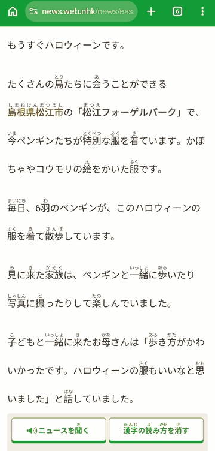
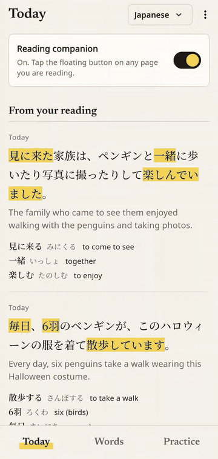

<p align="center">
  
</p>

<h1 align="center">LinguaScreen App</h1>

App frontend for LinguaScreen built with Flutter.

LinguaScreen is a language learning app which allows you to learn from reading books in languages you want to learn. It provides an overlay which provides translation and AI powered explanation for why a sentence is structured in a way or why a word is used in a context.

## Demo

| Reading with the overlay | Quizzes and flashcards |
| --- | --- |
|  |  |

## Backend Code

https://github.com/KrisNathan/linguascreen-api-go

~~OLD API: https://github.com/MMADUs/linguascreen-api~~

## Supported Platform

Currently we only support Android.

## Development

Install dependencies:

```sh
flutter pub get
```

Connect to an Android Device using USB Debugging or starting an Android Emulator.
You can start an Android Emulator Device using either Android Studio or this command:

```sh
flutter emulators
```

```sh
flutter emulators --launch <DEVICE_NAME>
```

Launch the debug mode, either using VSCode Flutter Debug/Android Emulator Debug/Flutter CLI:

```sh
flutter run
```

## Building

```sh
flutter build apk
```

## flutter_launcher_icons

https://pub.dev/packages/flutter_launcher_icons

If app icon is changed, it is necessary to run these commands:

```sh
flutter pub get
dart run flutter_launcher_icons
```

## Contributors

- [@KrisNathan](https://github.com/KrisNathan) (Kristopher N.)
- [@orde-r](https://github.com/orde-r) (Danielson)
